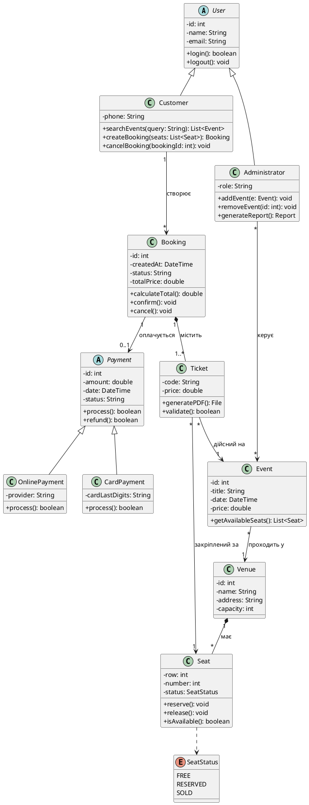

# Завдання 1. Діаграма класів (UML Class Diagram) — Система бронювання квитків

## 1. Опис предметної області (3–5 речень)
Система онлайн-бронювання квитків призначена для автоматизації процесу перегляду подій, вибору місць на інтерактивній схемі залу та придбання електронних квитків клієнтами. Вона забезпечує облік інформації про події, майданчики проведення, схеми залів і цінові категорії квитків. Користувачі можуть здійснювати резервування місць із фіксацією часового вікна для безпечної безготівкової оплати. Адміністратори системи здійснюють управління репертуаром подій, конфігурацією залів, а також мають доступ до звітності та валідації квитків на вході.

---

## 2. Основні класи системи, атрибути та методи

### 1) `User` (Абстрактний базовий клас користувача)
- **Атрибути:**
  - `id: int` — унікальний ідентифікатор користувача;
  - `name: String` — повне ім'я (ПІБ);
  - `email: String` — електронна пошта (логін для входу).
- **Методи:**
  - `login(): boolean` — авторизація в системі;
  - `logout(): void` — вихід із сесії.

### 2) `Customer` (Клієнт / Покупець, наслідує `User`)
- **Атрибути:**
  - `phone: String` — контактний номер телефону.
- **Методи:**
  - `searchEvents(query: String): List<Event>` — пошук подій за назвою чи критеріями;
  - `createBooking(seats: List<Seat>): Booking` — створення нового бронювання для обраних місць;
  - `cancelBooking(bookingId: int): void` — скасування активного бронювання.

### 3) `Administrator` (Адміністратор системи, наслідує `User`)
- **Атрибути:**
  - `role: String` — рівень доступу/роль адміністратора.
- **Методи:**
  - `addEvent(e: Event): void` — додавання нової події або сеансу в розклад;
  - `removeEvent(id: int): void` — видалення або деактивація події;
  - `generateReport(): Report` — формування фінансового та операційного звітів.

### 4) `Booking` (Бронювання / Замовлення)
- **Атрибути:**
  - `id: int` — номер замовлення;
  - `createdAt: DateTime` — дата та точний час створення броні;
  - `status: String` — поточний статус (`CREATED`, `PENDING`, `CONFIRMED`, `CANCELLED`);
  - `totalPrice: double` — загальна сума до оплати.
- **Методи:**
  - `calculateTotal(): double` — підрахунок вартості з урахуванням обраних місць;
  - `confirm(): void` — підтвердження бронювання після успішної транзакції;
  - `cancel(): void` — скасування та вивільнення зарезервованих місць.

### 5) `Ticket` (Електронний квиток)
- **Атрибути:**
  - `code: String` — унікальний штрихкод / QR-код квитка;
  - `price: double` — ціна конкретного квитка відповідно до категорії місця.
- **Методи:**
  - `generatePDF(): File` — генерація електронного бланка квитка у форматі PDF;
  - `validate(): boolean` — перевірка дійсності квитка контролером на вході.

### 6) `Event` (Подія / Захід)
- **Атрибути:**
  - `id: int` — ідентифікатор події;
  - `title: String` — назва заходу (концерт, вистава, матч тощо);
  - `date: DateTime` — дата і час початку;
  - `price: double` — базова вартість квитка.
- **Методи:**
  - `getAvailableSeats(): List<Seat>` — отримання переліку вільних місць на схемах залу.

### 7) `Venue` (Місце проведення / Зал)
- **Атрибути:**
  - `id: int` — номер майданчика;
  - `name: String` — назва локації / залу;
  - `address: String` — фізична адреса;
  - `capacity: int` — загальна місткість залу.

### 8) `Seat` (Місце в залі) та `SeatStatus` (Перелік статусів)
- **Атрибути:**
  - `row: int` — ряд;
  - `number: int` — номер місця;
  - `status: SeatStatus` — стан (`FREE`, `RESERVED`, `SOLD`).
- **Методи:**
  - `reserve(): void` — тимчасове резервування місця;
  - `release(): void` — звільнення місця (повернення в статус `FREE`);
  - `isAvailable(): boolean` — перевірка доступності місця.

### 9) `Payment` (Абстрактний платіж) та його підкласи
- **Атрибути:** `id: int`, `amount: double`, `date: DateTime`, `status: String`.
- **Методи:** `process(): boolean`, `refund(): boolean`.
- **Підкласи:** 
  - `CardPayment` — оплата банківською карткою (`cardLastDigits: String`);
  - `OnlinePayment` — оплата через онлайн-провайдерів / платіжні гаманці (`provider: String`).

---

## 3. Зв'язки між класами
У діаграмі реалізовано всі фундаментальні типи об'єктно-орієнтованих зв'язків UML:
1. **Наслідування (Generalization):**
   - `Customer` та `Administrator` успадковують базові поля і поведінку від абстрактного класу `User`;
   - `CardPayment` та `OnlinePayment` розширюють абстрактний клас `Payment`.
2. **Композиція (Composition — строга сильна агрегація за життям цілого):**
   - `Booking` "1" *-- "1..*" `Ticket` («містить»): квитки не можуть існувати поза замовленням; при знищенні замовлення квитки анулюються;
   - `Venue` "1" *-- "*" `Seat` («має»): фізичні місця нерозривно належать конкретному залу/майданчику.
3. **Асоціація (Association) та Агрегація:**
   - `Customer` "1" --> "*" `Booking` («створює»): клієнт може мати декілька замовлень;
   - `Booking` "1" --> "0..1" `Payment` («оплачується»): одне замовлення асоціюється з платіжною транзакцією;
   - `Ticket` "*" --> "1" `Event` («дійсний на»): квиток видається на конкретну подію;
   - `Ticket` "*" --> "1" `Seat` («закріплений за»): квиток фіксує обране місце в залі;
   - `Event` "*" --> "1" `Venue` («проходить у»): подія відбувається на визначеному майданчику;
   - `Administrator` "*" --> "*" `Event` («керує»): адміністратор публікує та оновлює інформацію про події.
4. **Залежність (Dependency):**
   - `Seat` ..> `SeatStatus` — клас `Seat` використовує перечислення `SeatStatus` для контролю доступності.

---

## 4. Вихідний PlantUML-код діаграми

Згенерована діаграма доступна у файлі: **[1.pdf](1.pdf)**.
